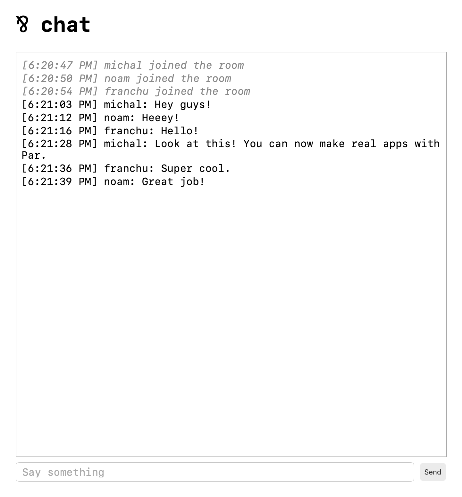

# Chat

A chat room in the browser. Open the page, pick a name, and talk with
everyone else in the room.

## Running

```sh
par run
```

Then open http://127.0.0.1:3000 in a few browser tabs.



## How it works

At the center is the room, `Room.Serve`. It keeps the list of members, and
serves many clients at once with
[`poll`/`submit`](https://par.run/book/nondeterminism/poll_submit), always
answering whoever speaks first.

The room has two kinds of clients:

- **The listener** (`Accept` in `Main.par`) accepts HTTP requests. It's the
  room's controller: it brings in new users, and tells the room to shut down
  when the server stops.
- **A session** (`Session` in `Main.par`) runs for every connected user and
  forwards what the user types to the room.

In this diagram, the arrows point from each client to the room, and the
labels name the protocols, defined in `Room.par`:

```
listener ──Controller──► room ◄──User── session
             .enter(User) ──┘    ◄──User── session
                                  ◄──User── ...
```

### A user's life

When a browser opens a WebSocket, the listener starts a session for it, and
hands the session over to the room with `.enter`. That's the last the
listener sees of this user. From here on, the session and the room talk
directly.

The session first asks to `.join` with a name. The room gives it an id, and
tells everyone that a new user arrived. After that, every message the user
sends becomes a `.say`, which the room passes on to everyone. When the
browser disconnects, the session sends `.leave`, and the room removes the user
and tells the others.

### One pool for everyone

The listener and the sessions speak different protocols, `Controller` and
`User`. To poll them all together, `Fan` and `FanUser` translate both into one
protocol, `Room`, following the
[fan pattern](https://par.run/book/nondeterminism/fan_pattern). There, each
`.enter` from the listener becomes a `.spawn`, which adds the new session to
the pool.

### Talking back to browsers

To send something to a user, the room pushes a line into the user's
`Outbox`. An outbox is an object that holds the user's WebSocket for writing,
but only offers two operations: `.push` a line, and `.close`. The session
creates it and brings it along when it joins. This keeps the room's logic
free of any I/O code. When a user leaves, the room drops their outbox.

### Shutting down

When the server stops (on Ctrl+C), the listener sends `.shutdown!`. The room drops all the
outboxes, which closes every browser's connection, so each session soon
leaves. The room then keeps polling with a new handler
([`repoll`](https://par.run/book/nondeterminism/repoll)), which lets each
remaining client go until the pool is empty.
