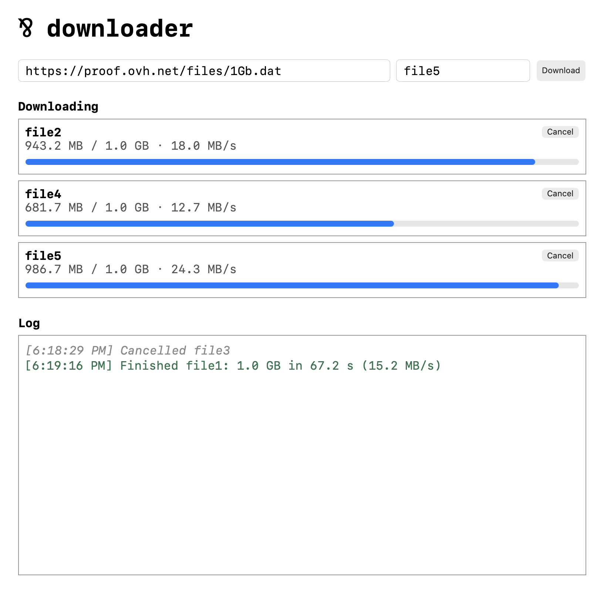

# Downloader

Downloads files into a `Downloads` directory. A web page starts downloads,
shows their progress live, and cancels them. A cancelled or failed download
leaves no partial file behind.

## Running

```sh
par run
```

Then open http://127.0.0.1:3000. Stopping the server with Ctrl+C cancels all
running downloads before it exits.



## How it works

At the center is the tracker, `Tracker.Serve`. It keeps track of the running
downloads, and serves many clients at once with
[`poll`/`submit`](https://par.run/book/nondeterminism/poll_submit), always
answering whoever speaks first. The tracker knows nothing about HTTP or
files. It only sees the protocols defined in `Tracker.par`, and all the I/O
lives in `Main.par`.

The tracker has two kinds of clients:

- **The controller** (`Control` in `Main.par`) accepts HTTP requests. It
  starts and cancels downloads, brings in viewers, and tells the tracker to
  shut down when the server stops.
- **A download** (`Download` in `Main.par`) runs for every file. It's a
  `Stream` from the standard library, so it does nothing until the tracker
  asks for the next update. Each time it's asked, it copies data for about
  100 milliseconds, then reports how many bytes it copied.

The open web pages are viewers. The tracker sends them notices about the
downloads, and never waits to hear from them, so they stay out of the pool.

In this diagram, the arrows point from each client to the tracker, and the
labels name the protocols:

```
controller ──Controller──► tracker ◄──Download── download
   .start(_, Download) ──┘    │     ◄──Download── download
                              │      ◄──Download── ...
                              └──Notice──► viewers
```

### A download's life

Every download has a name, which is also the name of its file. Two downloads
with the same name can't run at once, because they'd write to the same file.

When a request to start a download comes in, the controller creates the
download and hands it over to the tracker with `.start`, together with its
name. If that name is already taken by a running download, the tracker
answers `.false!` and drops the new one. Nothing has asked it for an update yet, so it never touched the
network. Otherwise, the tracker answers `.true!`, and from here on, it talks
to the download directly.

The tracker passes every update on to the viewers as a notice, and right away
asks the download for the next one. So the download keeps copying while the
tracker deals with other clients. When the download finishes or fails, the
tracker tells the viewers and forgets it.

### One pool for everyone

The controller and the downloads speak different protocols. To poll them all
together, `Fan` translates both into one protocol, `Client`, following the
[fan pattern](https://par.run/book/nondeterminism/fan_pattern). There, a
started download joins the pool next to the controller.

### Cancelling

A download can't be stopped in the middle of copying a batch, so `.cancel`
only marks it. When the download reports its next update, the tracker closes
it instead of asking for more, and the download deletes its partial file.
That way, a download stops within about 100 milliseconds of being cancelled.

### Viewers

A viewer is an object that holds a web page's WebSocket for writing, but only
offers two operations: `.push` a notice, and `.close`. Turning notices into
JSON happens inside it, too, so the tracker's logic stays free of any I/O
code. The controller creates a viewer for every page that connects, and hands
it over with `.watch`.

The tracker keeps a list of viewers and pushes every notice to all of them.
A push never makes the tracker wait for a browser. If an earlier send to the
browser failed, the push answers `.none!`, and the tracker forgets that
viewer. A newly opened page first gets notices about the downloads already
running.

### Shutting down

When the server stops (on Ctrl+C), the controller sends `.shutdown!`. From then on, the
tracker cancels every download as soon as it reports, and tells the viewers.
Once the last download is gone, the pool is empty. The tracker drops the
viewers, which closes their connections, and the program ends.
