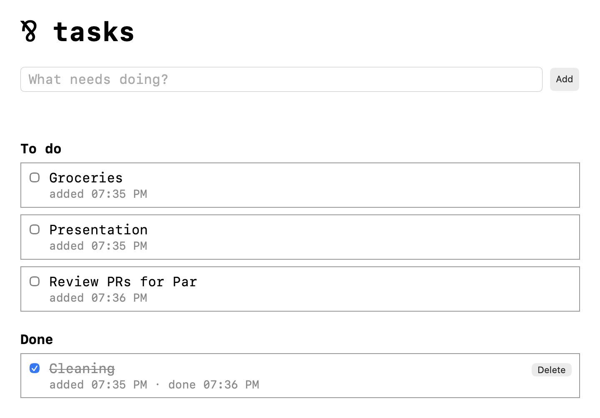

# Tasks

A task list in the browser, stored in SQLite. Add tasks, mark them as done
or not done, and delete the ones you've finished. Every task remembers when
it was added and when it was done.

## Running

```sh
par run
```

Then open http://127.0.0.1:3000. The tasks are kept in `tasks.db`, which is
created on the first run.



## How it works

The tasks live in the database, and SQLite lets many connections use it at
once. So no process in the program needs to own the tasks, and there's no
central server like in the chat or the downloader. The program serves every
request on its own, all of them concurrently.

The program has two parts:

- **The listener** (`Main` in `Main.par`) opens the database, then accepts
  HTTP requests one by one.
- **A handler per request** (`Handle` in `Main.par`) does what the request
  asks for, responds, and ends.

### A request's life

When a request comes in, the listener first splits off a new handle to the
database with `.split`. The handle is the handler's own way to talk to the
database. Then the listener starts a handler with the request and the handle,
and goes right back to waiting for the next request. It doesn't wait for the
handler to finish.

The handler figures out what the request wants (`Route`), and calls one of
the operations in `Tasks.par`: `All`, `Add`, `Complete`, `Uncomplete`, or
`Delete`. Each one runs a single SQL statement on the handler's handle. The
handler then turns the result into JSON and responds.

Statements on one handle run in order, one after another. Because every
handler has its own handle, a slow statement in one request doesn't hold up
any other.

### The database

`Tasks.par` holds all the SQL. A task is a row with an id, a title, and two
times: `created_at`, and `completed_at`, which is empty for a task that isn't
done. The times are stored as text, taken from Par's clock rather than
SQLite's.

### Shutting down

When the server stops (on Ctrl+C), the listener stops accepting requests and
drops its handle to the database. Handlers still in progress keep their own
handles, so they finish their requests before the program ends.
